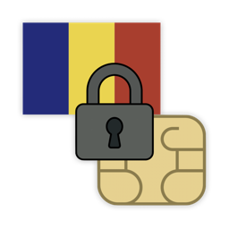

<p align="center"></p>

# RO CEI Connector

**Plug in your Romanian ID card and your Mac just uses it.**

The Romanian electronic ID card (CEI) carries two certificates: one for logging in to websites such
as the MAI hub, one for signing documents. The official IDEMIA software needs the card added by hand
and can freeze so badly that only a reboot helps.

RO CEI Connector is a native macOS driver for the card. Insert it into any smart card reader and
Safari, Keychain Access and every app that uses the keychain see both certificates. Take it out and
they're gone. It contains no IDEMIA code and runs nothing in the background.

## Using it

Insert the card. You don't need to open the app.

| Certificate | PIN | For |
| --- | --- | --- |
| RO eID Authentication | 4 digits | logging in to websites |
| RO eID Signature | 6 digits | signing documents, e.g. with [Signer](https://github.com/alxrxs/signer) |

macOS asks for the PIN when an app first uses a certificate. A PIN of the wrong length never reaches
the card, so typos don't cost you a try.

The app shows what IDplugManager shows: card details, tries left on each PIN, both certificates
(with export), PIN change, and your personal data after you enter your PIN. It's in English and
Romanian.

## Requirements

- macOS 27 or later
- Swift 6.3 or later, from Xcode or the Command Line Tools (`xcode-select --install`)
- Any contact smart card reader

## Install

There is no prebuilt download; both ways below build it from source on your Mac. Use one or the
other, not both.

### Homebrew

```sh
brew tap alxrxs/tap
brew trust alxrxs/tap
brew install alxrxs/tap/rocei-connector
ln -sfn "$(brew --prefix)/opt/rocei-connector/RO CEI Connector.app" "/Applications/RO CEI Connector.app"
open "/Applications/RO CEI Connector.app"
```

Opening the app once registers the card driver. Do it again after each `brew upgrade`.

### From source

```sh
git clone https://github.com/alxrxs/ROCEIConnector.git
cd ROCEIConnector
./build.sh install
```

This runs the tests, builds the app, puts it at `/Applications/RO CEI Connector.app` and registers
the driver. If the card was already in, take it out and put it back. `security list-smartcards`
shows it once macOS sees it.

`./build.sh` on its own only builds `build/RO CEI Connector.app`.

### Uninstall

Delete `/Applications/RO CEI Connector.app` (and `brew uninstall rocei-connector` if you used
Homebrew). The driver goes with it.

## Caveats

- **No Mac login with the card.** macOS needs a key that can decrypt to log in with a smart card;
  both keys on the Romanian card can only sign.
- **Signatures are advanced, not qualified.** They're legally valid in Romania, but not equivalent
  to a handwritten signature elsewhere in the EU.
- **Contact readers only**, no NFC.
- **No photo or fingerprints.** The card only gives those to government terminals.

## Development

```sh
./build.sh           # unit tests, then build/RO CEI Connector.app
./build.sh install   # build, install to /Applications and register the driver
log stream --predicate 'subsystem == "com.alxrxs.rocei.connector"'
```

`Shared/CEICard` speaks the card's protocol and is tested against a fake card; `ROCEIExtension` is
the CryptoTokenKit driver; `ROCEIConnector` is the SwiftUI app. `build/cei-test` is a read-only
diagnostic for a real card. No Xcode project: the Command Line Tools are enough.

IDEMIA's library coordinates apps through a system-wide lock; when one of them hangs holding it,
everything that uses the card waits forever. Here macOS owns the reader and the driver talks to the
card directly, one request at a time.

Releases are tagged `vX.Y.Z`; `build.sh` stamps the latest tag into the app's version.

## License

[AGPL-3.0](LICENSE). Copyright © 2026 Andrei.
